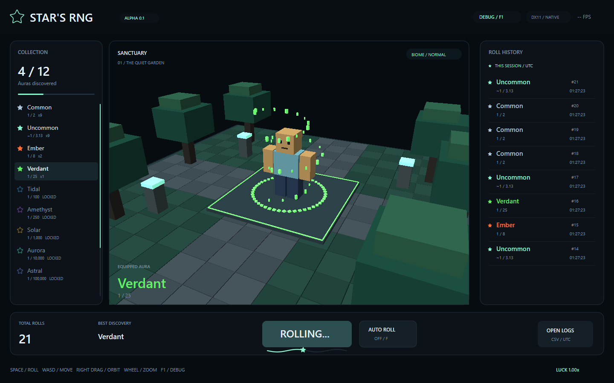
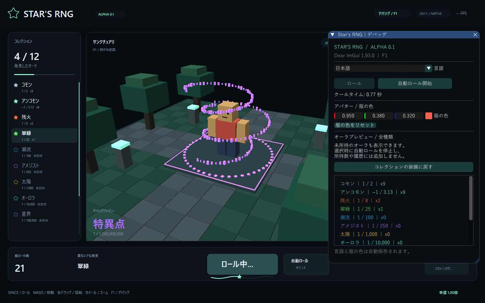

# Star's RNG — Alpha 0.1

C++20 / DirectX 11で動く、Windows向けの軽量なオーラ抽選ゲームです。



## 起動と操作

[Windows用ZIP](https://github.com/rx107/aura-rng/releases/tag/v0.1.1-alpha.1)を展開し、**StarRng.exe**を起動してください。`data`をEXEと同じ場所に置きます。Windows 10 / 11 x64向けです。ゲームエンジン、追加DLLのインストール、実行時のネット接続は不要です。

| 操作 | キー / マウス |
| --- | --- |
| ロール | ROLL / ロールボタン、Space、R |
| 自動ロール | AUTO ROLL / 自動ロールボタン、F |
| オーラの装備 | コレクションの所持済みオーラをクリック |
| デバッグ・言語・服の色 | 右上のDEBUG / デバッグ、F1 |
| 移動 | WASD、矢印キー |
| カメラ | 右ドラッグで回転、ホイールでズーム |
| リスト | 左右のパネル上でホイール |
| 終了 | Esc |

**ロールしても表示中のオーラは変わりません。** 所持数と履歴を更新し、通常の装備変更はコレクションから行います。クールタイムは1.4秒。丸みのある星が波打つシークバーを左から右に進み、終了時に自然に消えます。

## Dear ImGuiデバッグ

F1でパネルを開きます。

- ロール、自動ロールの開始・停止。
- 未所持を含む全オーラのプレビュー。選択時に自動ロールを停止。
- プレビューではロール数・所持数・履歴・CSVを変更しません。
- 「コレクションの装備に戻す」、またはコレクションで装備を選ぶとプレビューを解除。
- RGBの数値入力やカラーピッカーで服の色を変更。
- English / 日本語の即時切り替え。メイン画面とデバッグ画面に適用。
- 言語と服の色は自動保存し、次回起動時に復元。



Dear ImGui v1.93.0の公式ソースとWin32 / DX11バックエンドを同梱・静的リンクしています。日本語フォントはWindows上のYu Gothic、MS Gothic、Meiryoから読み込みます。Windowsフォントは再配布しません。該当フォントがない環境ではパネルに案内を表示します。

## オーラと確率

12種類のオーラを収録。旧Stillは**Common**、旧Glimmerは**Uncommon**に名称変更し、保存互換性のため内部IDを維持しています。

Commonは**正確に1/2（50%）**。Uncommonは他のオーラへ割り当てた残り（約31.99%、表示は`~1 / 3.13`）を受け取ります。Emberは1/8、Singularityは1/1,000,000,000です。全12種類の実確率は重複せず、合計100%、1ロールの結果は常に1種類です。

`data/auras.csv`の名前、確率、色、粒子数、半径、速度を編集すると次回起動時に反映されます。[データ仕様](docs/aura-format.md)を参照してください。オーラ作成ソフト自体は今後の拡張です。

## 保存と互換性

以前と同じ`%LOCALAPPDATA%\AuraRng\`に保存します。「ログを開く」から確認できます。

| ファイル | 内容 |
| --- | --- |
| `progress.txt` | 総ロール数、所持数、装備ID |
| `rolls.csv` | 全ロールの番号・UTC時刻・ID・名前・設定上の分母 |
| `settings.txt` | 言語と服のRGB色 |

画面履歴は今回の起動中の直近200件、CSVは全件追記です。プレビューは一時的な表示だけで、保存中の装備には反映しません。過去のCSV行のStill / Glimmerは記録当時の名前を保持します。セーブは一時ファイルから置き換え、破損した進行セーブはバックアップを保持します。通常起動は1プロセスに制限し、旧版との保存の競合も防ぎます。

## ビルド

Visual Studio 2022 / Build Tools 2022の「C++によるデスクトップ開発」、Windows SDK、CMakeが必要です。ImGuiの別途取得は不要です。

```bat
build.cmd
build-release\StarRng.exe
```

```bat
cmake -S . -B build -G "Visual Studio 17 2022" -A x64
cmake --build build --config Release --parallel
ctest --test-dir build -C Release --output-on-failure
```

コアテストはLinuxでも実行できます。DirectXアプリはWindowsで生成します。`--warp`でソフトウェア描画、`--debug`でパネルを開いて起動できます。

3D部分は共有キューブのインスタンス描画で1 draw call、浮遊粒子は最大160個です。通常はVSync、非アクティブ時は最大15FPS、最小化時は描画を停止して自動ロールを続けます。ImGuiパネルはUIの描画バッチを追加します。

Luckは1.00倍、バイオームはNormal固定です。ポーション、クラフト、バイオーム別抽選、音、オンライン機能は今後の拡張です。[検証記録](docs/validation.md)、[設計](docs/architecture.md)、[Dear ImGuiの出典](third_party/README.md)も参照してください。
