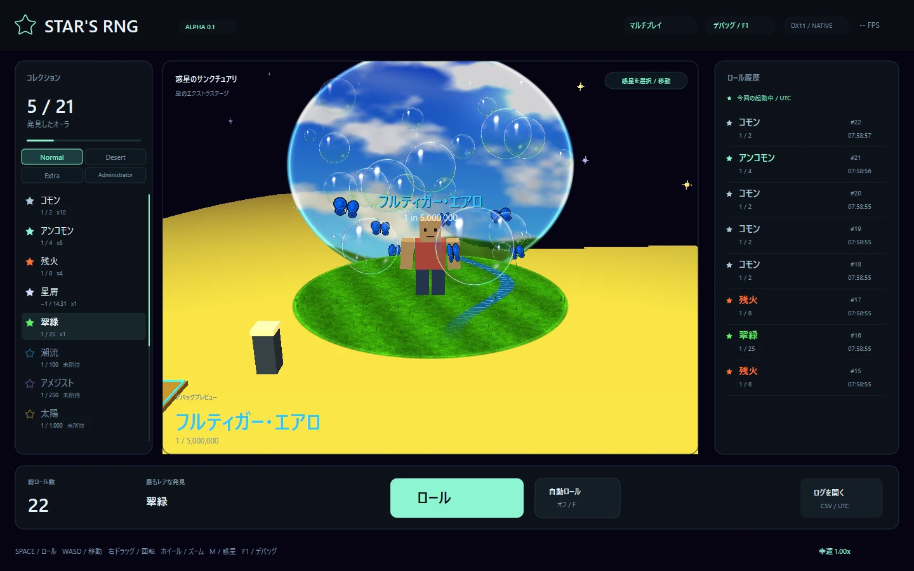

# Star's RNG — Alpha 0.1 / v0.1.18

C++20 / Win32 / DirectX 11で動くWindows向けのオーラ抽選ゲームです。



## 今回の変更

- **新オーラRed johnを追加。** 淡い壁の部屋、低いベッド、赤い笑顔と、片膝を立てて座るアバターです。Extraステージ限定、基礎確率は1 in 6,000,000。ブロックとVRMで座りポーズを共有します。[見た目とポーズの調整](docs/red-john-guide.md)
- **約10.9秒の専用CutSceneを追加。** 黒い導入から青・白・黄色の帯、目の接写、横顔、大きなRED JOHNの文字へ進む演出です。映像はコードで描き、音は数式で合成したオリジナル導入曲を同梱しています。
- **F1から未所持でも確認可能。** オーラ一覧のRed johnと「カットシーンのみ再生」で試せます。最後まで再生するとRed johnを一時表示し、Esc・停止では元の表示へ戻ります。プレビューは所持数・実装備・Roll Historyを変えません。

## 遊び方と入手場所

**Roll**または**R / Space**で1回抽選し、**AutoRoll / F**で自動抽選します。**WASD / 矢印**で移動し、右ドラッグで視点を回します。右へ動かすと左回転、左へ動かすと右回転。ホイールでズームします。

**M**または**PLANETS / TRAVEL**からロケットで惑星を移動できます。庭園・砂漠・海・森・火山・Extraの6ステージです。ロケットの発着場とリスポーンは共通のXZ座標です。通常ステージは64×64、Extraは同じ範囲に収まる星形で、外周から落ちないよう移動を制限します。

| Collectionフォルダー | 収録数 | 入手できる場所 |
| --- | --- | --- |
| Normal | 13 | Common〜Singularity。すべてのステージ |
| Desert | 3 | Dune / Mirage / Pharaoh。砂漠だけ |
| Extra | 6 | Pixelation / Equinox / BreakThrough / Illusionary / Frutiger Aero / Red john。Extraだけ |
| Administrator | 1 | Nanally。F1のプレビュー専用 |

Commonは正確に1/2、Uncommonは1/4。Duneは1/50、Mirageは1/5,000、Pharaohは1/250,000。Extraの6種の基礎確率は順に1/2,000,000、1/2,500,000、1/3,000,000、1/4,000,000、1/5,000,000、1/6,000,000です。これらは `data/auras.csv` で変更できます。Commonなどの既存分母は維持し、余りをStardustに割り当てます。ステージごとに合計100%となります。

Luck L倍は「基礎抽選をL回した中で最もレアな結果」と同じ分布をCDFで計算し、結果を1個だけ記録します。入手対象外のオーラはLuckを上げても出ません。F1 → ワールドで現在の惑星の実確率を確認できます。[詳しい確率仕様](docs/aura-format.md)

取得済みオーラはCollectionの行を選んで装備します。普通のRollでは表示オーラを変更しません。Equinox / BreakThrough / Red johnの当選時は入手CutSceneを流し、最後にそのオーラを一時プレビューします。**保存される装備はCollectionから変更**します。

## マルチプレイを試す

画面上の**MULTIPLAYER / マルチプレイ**を開き、名前を確定し、好きな写真を選びます。写真は中央を160pxの正方形にして共有し、元の写真やファイル名は送信しません。設定後も名前・写真はいつでも変更でき、接続中なら再接続して反映します。

友達と遊ぶ場合は接続先に**自分またはホストのHTTPS URL**を入力します。接続が成功するとプロフィールが閉じ、移動・視点操作・Rollを使えます。プロフィールを開き直した場合は**「ゲームに戻る」またはEsc**で閉じられ、接続は続きます。**F1**ではプロフィールを閉じてデバッグ画面へ切り替わります。

自分のPCで試す場合はPython 3.10以上を用意し、同梱の**Start-local-server.cmd**を開いたまま、ゲームから **http://127.0.0.1:8765** へ参加します。自分用のVPSを運用する手順も同梱しています。[詳しい手順](docs/multiplayer.md)

位置・向き・歩行・服色・**現在表示中のオーラとLevel**を約10回/秒で共有します。F1の一時プレビューも相手に見えますが、実際の装備・所持数・Roll Historyは変わりません。相手はブロックアバターで表示し、VRMは送信しません。近い4人は詳細オーラ、それ以外は輪と色を使った軽い表示です。写真と名前はマルチ画面の一覧、名前・ID・オーラは頭上にも表示します。ロール・所持品・Luckは各PCに保存します。

## F1で自由に試す

**F1**でDear ImGuiのデバッグ画面を開きます。

- **プロフィール**：ユーザー名、Discord表示、保存される総ロール回数。
- **ワールド**：Roll / AutoRoll、Luck、惑星の即時切替、現在の排出確率。
- **アバター**：ブロック / ローカルVRM、服の色。
- **オーラ**：未所持も含む全オーラ、Singularity / PixelationのLevel、CutSceneのみ再生、BreakThrough字幕のタイミング調整。
- **音楽**：各BGMの差し替え、初期曲へ戻す、音楽・効果音の音量、PixelationとEquinoxのBPM・拍の時差。Equinoxは通常表示とCutSceneで別の設定です。

プレビューはAutoRollを止め、所持数・Roll History・実装備を変えません。CutSceneを最後まで見ると対応オーラをプレビューし、Esc / 停止なら直前の表示へ戻ります。プレビューは保存しません。

SingularityとPixelationは初取得Level 0、重複ごとに+1、最大3。Singularityは星 → 小ブラックホール → 大ブラックホールと星の吸収へ変化します。PixelationはLevel 1で高速化、2でPLAYER 1 / 2が同じ点へ弾を撃って衝突・爆発。3では周囲の回転をさらに速めてBGMを変更し、弾・衝突・爆発・アバター浮遊の速度は2と同じに保ちます。F1のLevelは一時的な上書きです。

Pixelationのキューブは**実際の音楽の再生時刻**に同期します。F1 → 音楽 → **キューブの鼓動**で自動推定を外すと、BPMを30〜300で指定できます。BPMは1分間の拍数で、120なら約0.5秒に1回です。拍の時差は-2〜+2秒、正の値で鼓動を遅らせます。音楽が再生されていない場合は鼓動せず、BGMのないLevel 0も同様です。

Equinoxは同じ拍を玉・文字・トレイル・爆発で共有します。標準では4拍で1周し、1拍ごとに玉の白黒が交換され、4拍ごとに床文字が進みます。「陰→陽→衡→無」の1巡は16拍です。F1 → 音楽で通常表示とCutSceneのBPM・時差を調整できます。BPMは30〜300、時差は-2〜+2秒で、`+.10`なら拍を0.1秒遅らせます。大きさ・尾の長さは[Equinoxの調整値](src/tuning/equinox.hpp)へ。

## 音声・VRM・Discord

提供者の許可を得た7つの音源と、Red john用に合成したオリジナル導入音をソースとWindows ZIPに同梱しています。Red johnの音は`tools/generate_redjohn_audio.py`から再生成でき、参考動画の音声は配布しません。The WeirdosはOgg Vorbisを同梱デコーダーで再生するため、追加コーデックは不要です。Equinoxの通常表示用の曲とCutScene用のM4Aは別の音源です。Equinox / BreakThroughのCutScene音声は必要な範囲だけ切り出しており、元動画のCollection部分は再生しません。[音声の一覧](data/audio/README.md)

**VRM・元の参考画像・参考動画は配布しません。** F1から自分のPCのVRMを選択してください。`Start-with-local-assets.cmd` はDownloadsのChocolat.vrmを指定する補助起動です。通常の立ち姿・歩行と、各オーラの固定ポーズをブロックとVRMで共有します。固定ポーズ中は移動しても歩行を混ぜません。VRM 0.x / 1.0の自己完結GLB、スキン、初期モーフ、ベースカラーに対応。Spring Bone・表情・MToon固有の影や輪郭は未対応です。

Discordデスクトップ版を起動すると、ユーザー名とロール回数をRich Presenceへ送ります。設定済みApplication IDを使用し、トークンは不要です。公開範囲はDiscord側のアクティビティ設定にも依存します。[Discord連携](docs/discord.md)

## 初心者向けの改造入口

[改造用ソースZIP v0.1.18](https://github.com/rx107/aura-rng/releases/download/v0.1.18-alpha.1/StarRng-v0.1.18-source.zip)を展開し、まず[初心者向け改造ガイド](docs/development-guide.md)を開いてください。

1. `src/tuning` の数字を1つだけ変更して保存。
2. ゲームを閉じて `Develop.cmd` を実行。
3. 開いたF1パネルで対象オーラを表示して確認。

[調整ファイル一覧](src/tuning/README.md)には「この値を変えると画面で何が変わるか」を記載しています。F1の設定はその場で変更、C++の変更は再ビルドで反映します。`Develop.cmd` の試作用セーブはソース内の `local-save` です。

## ビルドと保存

Visual Studio 2022 / Build Tools 2022の「C++によるデスクトップ開発」、Windows SDK、CMakeを用意します。依存ライブラリは同梱済みで、ビルド中の取得は不要です。

```bat
build.cmd
build-release\StarRng.exe
```

`build.cmd` はコアとDiscord IPC、Pythonが見つかる場合は専用サーバー・実WinHTTPの接続テストも実行します。`Develop.cmd` は自由な数値変更を試すためコンパイルのみ実行します。コアはLinuxでもテストでき、DirectXアプリはWindowsで生成します。`--warp` はソフトウェア描画、`--debug` はF1を開いて起動します。

通常の保存先は `%LOCALAPPDATA%\AuraRng\`。「ログを開く」から確認できます。`progress.txt` はID別在庫と実装備、`rolls.csv` は全ロール、`settings.txt` は設定です。画面履歴は起動中の最新200件。設定schema 9にEquinoxのBGMパス・通常表示とCutSceneのBPM・時差、PixelationのBPM・時差などを保存し、旧schema 1〜8も読み込めます。Still / Glimmerの内部IDは保存互換のため維持します。進行は一時ファイルから置き換え、読めない進行セーブはバックアップします。

## 今後の予定

マルチプレイは位置と見た目の共有まで実装しています。サーバー主体の抽選・進行保存、実績、各ステージのお宝による常時Luck上昇は今後の機能です。[次の機能に必要な準備](docs/next-features.md)に設計・保存・通信・サーバーなどを整理しました。オーラ作成ソフト、クラフト、ポーションも今後の拡張です。

[検証記録](docs/validation.md) / [設計](docs/architecture.md) / [依存ライブラリ](third_party/README.md)
