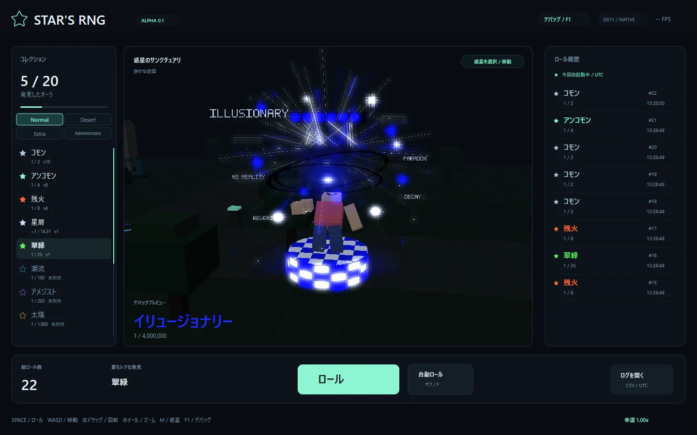
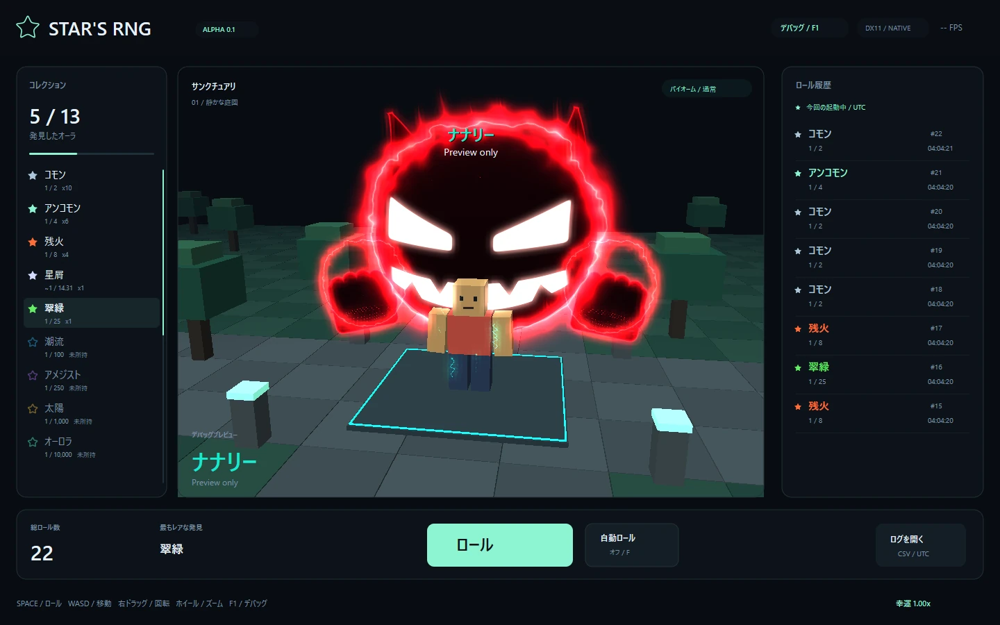
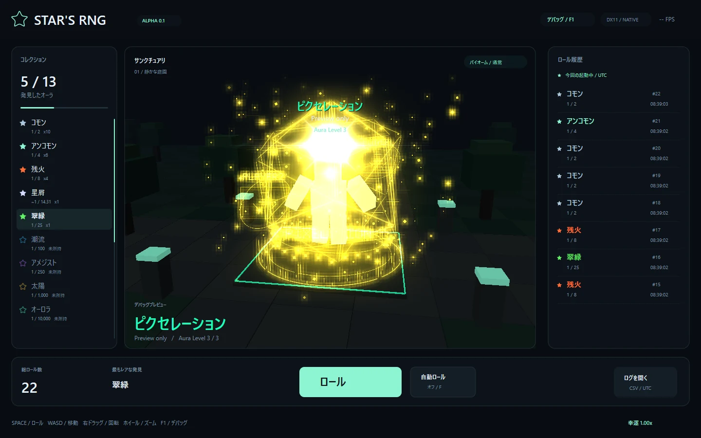
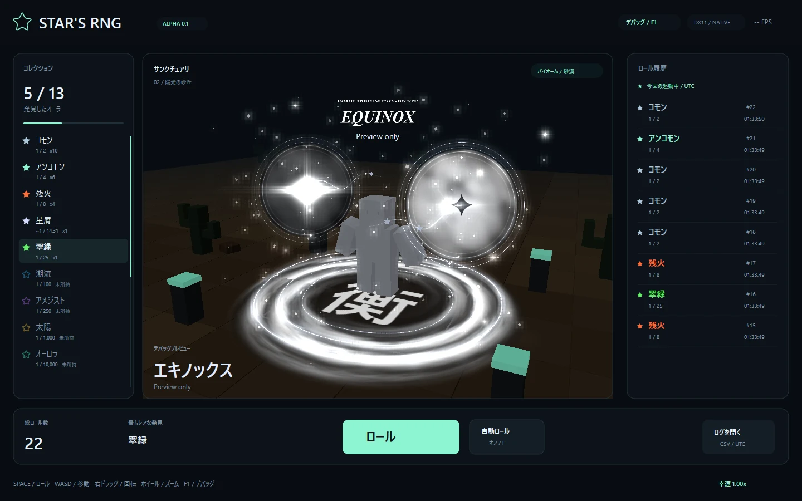
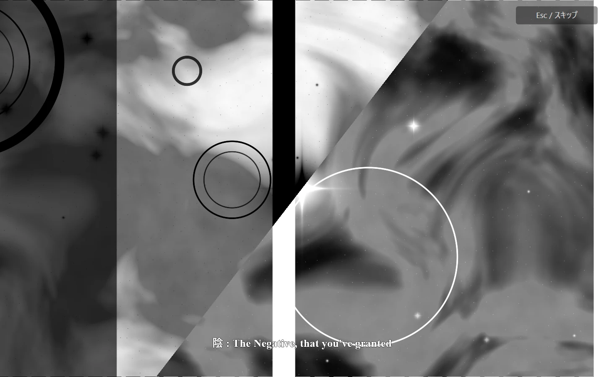
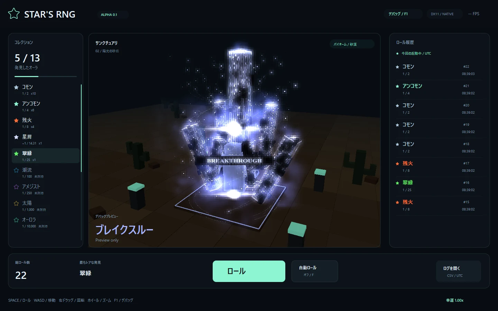
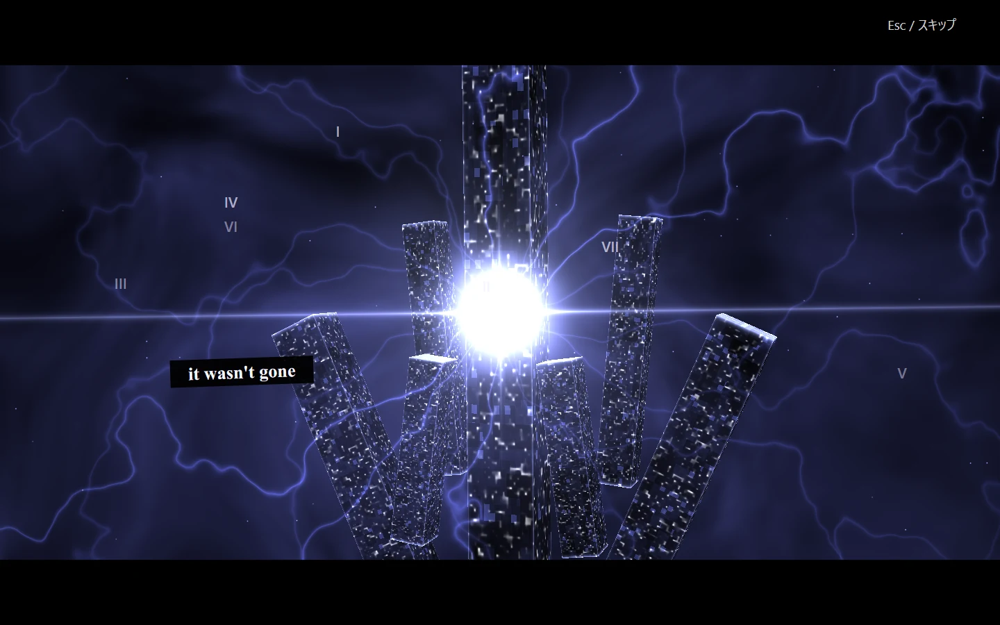
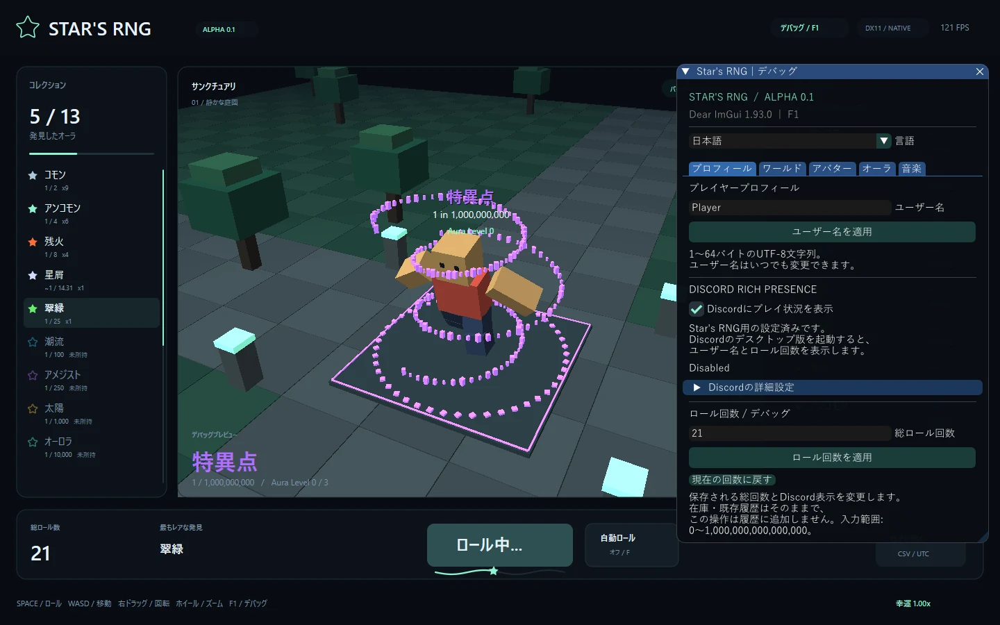
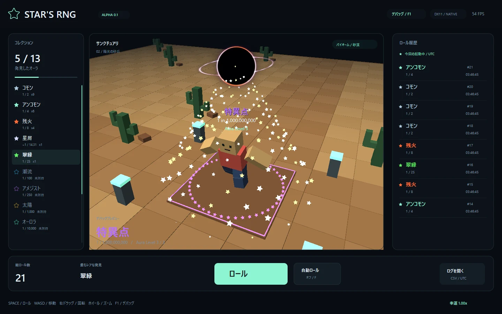

# Star's RNG — Alpha 0.1

C++20 / DirectX 11で動く、Windows向けの軽量なオーラ抽選ゲームです。

## 惑星をロケットで移動する


ワールド右上の **PLANETS / TRAVEL（惑星を選択 / 移動）**、または **Mキー** から行き先を選びます。庭園・砂漠・海・森・火山の5惑星を、離陸 → 宇宙航行 → 着陸の短い演出で移動できます。移動先は保存され、装備・所持オーラ・ロール履歴は引き継ぎます。海には島と桟橋・動く波、森には大きな木とホタル、火山には溶岩と火の粉があります。

**右ドラッグの左右回転を反転**しました。マウスを右に動かすと左回転、左に動かすと右回転します。上下とズームは従来どおりです。

BreakThroughの字幕は参考動画の各単語の出現フレームから時刻を計測し、再生中の音声サンプルを時計に使います。**F1 → オーラ → BreakThrough → 字幕タイミング / 秒** で全体の時差と単語ごとの時刻を調整・保存できます。マイナスは早く、プラスは遅くなります。[惑星移動と字幕調整の手順](docs/stage-and-cutscene-guide.md)も参照してください。

## Illusionaryと砂漠のオーラ



**F1 → オーラ → Illusionaryを表示 / 試作** で、黒い回転リボン5本、青白い放射光、細い破片、チェック模様、浮遊する文字・小さな画面を表示できます。添付アニメーションを参考にコードで再構成し、アバターは移動中も固定の浮遊ポーズを保ちます。Illusionaryは確率未設定の表示試作です。

砂漠をテーマにした **Dune / 砂丘（1 in 50）・Mirage / 蜃気楼（1 in 5,000）・Pharaoh / ファラオ（1 in 250,000）** は全惑星の通常ロールから取得できます。砂のらせん、陽炎と結晶、金のピラミッドと翼をそれぞれ軽量な発光描画で表現します。F1から未所持でも確認でき、表示プレビューだけでは所持数や履歴を増やしません。

[砂漠オーラの画像と改造方法](docs/desert-auras.md)

ロケットの発着場はリスポーンと同じ中央座標です。通常アバターが重ならないように機体を頭上へ置き、下を乗降スペースにしています。調整は `src/tuning/stages.hpp`、オーラは `illusionary.hpp` / `desert.hpp` に日本語コメント付きでまとめています。

## 自分で改造したい方へ

まずは[初心者向け・改造ガイド](docs/development-guide.md)を開いてください。準備、最初の数字変更、画面での確認、失敗したときの戻し方を順番に説明しています。

[改造用ソースZIP（v0.1.11）](https://github.com/rx107/aura-rng/archive/refs/tags/v0.1.11-alpha.1.zip)を展開し、`src/tuning`の数字を1つ変更 → 保存 → ゲームを閉じて`Develop.cmd`、で試せます。[調整ファイル一覧](src/tuning/README.md)に「何を変えるならどのファイルか」をまとめています。ゲーム中のF1設定はその場で変更でき、C++の設定変更は再ビルドで反映します。

`Develop.cmd`はコンパイル後、F1パネルを開いて起動します。試作用のセーブはソースフォルダー内の`local-save`へ保存し、通常プレイの進行データと分けます。`build.cmd`は標準値向けの回帰テストも実行し、`Develop.cmd`は見た目や速度を自由に試すためコンパイルのみ行います。

## Nanallyの試作



**F1 → Auras / オーラ → Nanallyを表示**で確認できます。プレイヤーの後ろに、黒赤の大きな生物、白く光る目と笑顔、左右の大きな拳、その周りの赤い炎を描画します。プレイヤーの近くには、小さく短く点滅する青緑色の電撃を散らしています。生物とエフェクトはプレイヤーの移動に追従し、ブロック・ローカルVRMとも通常の立ち姿と歩行を使用します。

カメラを生物の背後へ回した場合は、本体を滑らかに半透明にしてプレイヤーを見やすくします。正面では黒い本体を不透明に保ちます。

参考画像の形や色をもとにコードで描画し、参考画像そのものはソース・配布ZIPへ含めていません。**確率未設定の表示試作**なので通常ロール・AutoRollには出現せず、プレビュー選択時はAutoRollを停止します。所持数・装備・ロール履歴は変更しません。

## Pixelationの試作



**F1 → Auras / オーラ → Pixelationをプレビュー**で確認できます。添付されたSol's RNGの参考画像をもとに、強い発光、3つの回転するワイヤーキューブ、床のリング、180個のピクセル片と20個の光点、Player 1 / 2の浮遊HUD、ビットマップ文字の`PIXELATION`を実装しています。レベル0では色が約2秒でシアン → ライム → オレンジ → マゼンタ → シアンと巡ります。ブロック・ローカルVRMとも腕を少し広げて浮遊し、移動中も同じ姿勢を維持します。

F1の**Pixelation / Aura Level**でレベル0〜3を試せます。

| Level | 演出と音楽 |
| --- | --- |
| 0 | 従来の演出。色の循環は約2秒、BGMなし |
| 1 | 回転・粒子・色の循環を1.6倍速にし、Redline Shiftを再生 |
| 2 | 1.6倍速を維持。Player 1 / 2が同時に球を放ち、同じ場所で衝突。命中した瞬間に閃光・衝撃波・破片が広がり、発射音と厚みのある衝突音を再生 |
| 3 | キューブ・粒子・色・HUD公転を3倍速へ加速。弾の発射・飛行・衝突から爆発・アバターの浮遊はLevel 2と同じ1.6倍速を維持。爆発は大きくし、BGMをCensoredへ変更 |

プレイヤーの回転軌道は打ち合い中も続きます。周囲の演出と弾・浮遊の時計を分け、レベル変更で回転位置を保ち、飛行中の弾も発射位置から跳ばないようにしています。レベルは初取得0・重複ごとに+1・最大3の規則を持ちますが、**今回は確率未設定の表示試作**なので通常ロール・AutoRollからは出現しません。デバッグで選択するとAutoRollを止め、所持数・履歴を変更しません。レベルは一時的な表示設定で、保存しません。

## Equinoxとカットシーン



**F1 → Auras / オーラ → Equinoxを表示**で、白黒の天体、光の星、銀色の床リングと霧、粒子、`EQUINOX`の文字を確認できます。天体の内部は何層もの雷雲が動き、短い二連の稲光が雲を照らします。約0.78秒ごとに白黒を一斉に入れ替え、常に白玉と黒玉が1個ずつになります。各球の中心光から波打つ光跡と星が個別に流れ、主タイトルと副題も天体と同じタイミングで白黒を交換します。床面の`衡`は最も内側の円に余白を残して収まり、少量の霧が周囲からアバターへ集まります。ブロックとVRMは落ち着いた浮遊姿勢を取り、移動中も固定します。



**カットシーンのみ再生**で、約10.9秒の独立した演出を再生します。回転する白黒の雲、星やリング、陰・陽・衡・無の4段階の字幕をコードで描画します。**Esc**またはデバッグの停止ボタンでスキップできます。再生中はAutoRollを止め、移動・ロールを受け付けず、終了後は元の表示・レベル・デバッグ画面へ戻ります。再生操作によってオーラを取得・装備したり、履歴を増やしたりすることはありません。

Downloadsに`EquinoxReworkedCutscene.mp4.mp4`がある場合だけ、そのローカル動画の音声を先頭から再生します。約10.9秒で音声も停止し、動画の後半には進みません。ファイルがない場合も映像演出は正常に動作します。参考画像・動画、VRMはソース・配布ZIPへ含めていません。

## BreakThroughとカットシーン



**F1 → Auras / オーラ → BreakThroughを表示**で確認できます。中央に伸びる高い塔、周囲の傾斜した塔、白青の光と床から巻き上がる渦、破片や粒子をコードで描画します。各柱は個別の周期でゆっくり上下に浮遊し、名前はアバターの頭上に表示します。ブロックとローカルVRMの両方に対応し、移動中も浮遊姿勢を維持します。



BreakThrough欄の**カットシーンのみ再生**から約30秒の演出を確認できます。柱の上下浮遊は通常表示のみで、カットシーン中の柱は静止します。カメラ・霧・発光の演出は引き続き動きます。**Esc**またはデバッグの停止ボタンでスキップし、終了後は元の表示・レベル・デバッグ画面へ戻ります。未所持でも利用でき、所持数・装備・ロール履歴を変更しません。再生中はAutoRoll・移動・ロールを止めます。

Downloadsに`BreakthroughCutsceneV2.mp4.mp4`がある場合は、ローカル動画の音声を4.5秒の位置から30秒分再生します。元動画は同梱せず、ファイルがない場合もコードによる映像演出を確認できます。参考のGIFも同梱せず、塔や渦、雲などの細部はプログラムによる再現です。

## 起動と操作

[Windows用ZIP（v0.1.11）](https://github.com/rx107/aura-rng/releases/tag/v0.1.11-alpha.1)を展開し、**StarRng.exe**を起動してください。`data`をEXEと同じ場所に置きます。Windows 10 / 11 x64向けです。ゲームエンジン、追加DLLのインストール、実行時のネット接続は不要です。

| 操作 | キー / マウス |
| --- | --- |
| ロール | ROLL / ロールボタン、Space、R |
| 自動ロール | AUTO ROLL / 自動ロールボタン、F |
| オーラの装備 | コレクションの所持済みオーラをクリック |
| プロフィール・Discord・Luck・アバター・BGM・言語 | 右上のDEBUG / デバッグ、F1 |
| 移動 | WASD、矢印キー |
| カメラ | ステージ上から右ドラッグ。右へ動かすと左回転、左へ動かすと右回転。ホイールでズーム |
| 惑星を選ぶ | ワールド右上のPLANETS / TRAVEL、M。Esc / Mで閉じる |
| リスト | 左右のパネル上でホイール |
| 終了 | Esc |

**ロールしても表示中のオーラは変わりません。** 所持数と履歴を更新し、通常の装備変更はコレクションから行います。クールタイムは1.4秒。丸みのある星が波打つシークバーを左から右に進み、終了時に自然に消えます。

## Dear ImGuiデバッグ

F1でパネルを開きます。

| タブ | 操作 |
| --- | --- |
| Profile / プロフィール | ゲーム内ユーザー名、Discord表示の有効・無効とApplication ID、総ロール回数の変更 |
| World / ワールド | ロール、自動ロール、Luck倍率（1〜1,000,000）、通常 / 砂漠の切り替え、Luck反映後の各排出確率 |
| Avatar / アバター | ブロック / VRMの切り替え、VRMファイル選択、ブロックの服のRGB色 |
| Auras / オーラ | 全オーラの一時プレビュー、SingularityとPixelationのLevel 0〜3、所持レベルへ戻す、Equinox・BreakThroughのカットシーンのみ再生・停止 |
| Audio / 音楽 | Singularity / Pixelation用の3曲、任意ファイルの選択、音楽・効果音の音量、再生状態 |

- ロール、自動ロールの開始・停止。
- 未所持を含む全オーラのプレビュー。選択時に自動ロールを停止。
- プレビューではロール数・所持数・履歴・CSVを変更しません。
- 「コレクションの装備に戻す」、またはコレクションで装備を選ぶとプレビューを解除。
- RGBの数値入力やカラーピッカーで服の色を変更。
- English / 日本語の即時切り替え。メイン画面とデバッグ画面に適用。
- 言語・服の色・Luck・バイオーム・アバター形式・ローカルファイルの場所・音量・ユーザー名・Discord設定を自動保存。



Dear ImGui v1.93.0の公式ソースとWin32 / DX11バックエンドを同梱・静的リンクしています。日本語フォントはWindows上のYu Gothic、MS Gothic、Meiryoから読み込みます。Windowsフォントは再配布しません。該当フォントがない環境ではパネルに案内を表示します。

## プロフィール・Discord・総ロール回数

**F1 → Profile / プロフィール**でゲーム内の任意のユーザー名を入力し、**ユーザー名を適用**を押します。既定は`Player`、長さは1〜64 UTF-8バイトです。Discordアカウントのユーザー名とは別の名前で、日本語も使用できます。改行・制御文字は使用できません。

Discord表示は初期状態で有効です。Star's RNG用の公開Application ID `1560569853184573590`を組み込んでいるため、IDの手入力は不要です。同じWindows PCでDiscordデスクトップ版を起動し、ご本人のDiscord設定の**Activity Privacy / アクティビティのプライバシー**で共有を許可すると、`Username: 名前`と`Rolls: 回数`を送信します。表示するかどうかはDiscord側の設定にも従います。[Discord公式の共有設定の案内](https://support.discord.com/hc/en-us/articles/7931156448919-Activity-Sharing-on-Discord-FAQ)

接続後は名前・回数の変更を5秒以上の間隔で送信し、Discordを後から起動した場合も自動で再接続します。プロフィールのチェックを外すかゲームを終了すると、現在のアクティビティを消去する要求を送ります。トークン・追加SDK DLLの設定は不要です。実際のDiscordプロフィールでの表示確認は未実施です。接続状態の読み方と仕組みは[Discord連携](docs/discord.md)に記載しています。

同じタブの**総ロール回数 → ロール回数を適用**で0〜1,000,000,000,000,000の値へ変更できます。適用時はAutoRollを止め、在庫・既存履歴・最良オーラを変更せず、以後のロールで新しい回数から1ずつ増えます。過去のCSVは書き換えません。回数を戻した場合、今後のCSVのロール番号も新しい回数を起点にするため、過去の番号と重複することがあります。

## VRM・BGMの使い方

1. **F1 → アバター → VRMを選択**から、お手元の`Chocolat.vrm`などを選択します。選択後はVRMに切り替わり、形式のコンボボックスでブロックへ戻せます。
2. BGMの`Tides_of_the_Outer_Reach.mp3`は作者の許可により同梱しています。**音楽 → 同梱BGMを使用**で選べます。初期状態ではこの曲を使用します。任意の曲も選択できます。
3. コレクションの装備、またはデバッグのプレビューを**Singularity / 特異点**にすると曲をループ再生します。別のオーラへ変更するとフェードアウトして停止します。ロール結果だけでは再生条件は変わりません。
4. PixelationのLevel 1〜2では`Redline_Shift.mp3`、Level 3では`Censored.mp3.mpeg`をループ再生します。この2曲は提供者の公開配布許可により**リリースZIPへ同梱**しています。GitHubのソースには大きな音源ファイルを含めていません。
5. ソースからビルドする場合は、リリースZIPの`data/audio`を実行ファイル側の同じ場所へコピーするか、同名ファイルをDownloadsへ置くか、F1の音楽タブで任意の場所の曲を選択してください。発射・衝突の効果音はプログラムで合成する短いオリジナル音です。

VRMは再配布せず、ローカルファイルとして読み込みます。配布ZIP・GitHubにアバターは含めていません。VRMを移動した場合は再選択してください。ゲームがローカルファイルをネットへ送信することはありません。

`Chocolat.vrm`をダウンロードフォルダーに置いている場合は、同梱の`Start-with-local-assets.cmd`から起動すると、その場所を指定した状態で開始できます。F1でアバター形式をVRMに切り替えてください。通常は`StarRng.exe`とファイル選択画面を使います。

VRM 0.x / 1.0の自己完結したGLB、メッシュ、スキン、初期モーフ、ベースカラーテクスチャに対応。腕を下ろした立ち姿と、移動時に腕・脚・膝が動く歩行を実装しています。Chocolatの衣服側の骨格にも同じ動きを適用します。Singularity・Pixelation・Equinox・BreakThroughではブロックと同じ固定ポーズを取り、移動中も姿勢を維持します。表情、Spring Bone、MToon固有の影・輪郭は未実装です。読み込みは別スレッドで行い、失敗時はブロックを表示して理由を出します。テクスチャは最大2048pxへ縮小し、読み込み後は巨大な元ファイルや未使用モーフを保持しません。上限は512MiB・200万頂点・1スキン512ボーンです。

ステージは**64×64**です。庭園・砂漠・海・森・火山を惑星選択画面から移動できます。F1のワールドタブでは直接切り替えて制作中の景観を確認できます。現在は景観の切り替えで、バイオーム限定オーラは今後の拡張です。アバターの頭上にはオーラ名と`1 in 4`形式の基礎確率を表示します。

## Singularity / Aura Level



初取得でレベル0、その後1個重複するたびに上がり、レベル3で最大になります。過去の所持数も反映し、4個以上持っていればレベル3です。レベルは演出だけを変え、抽選確率は変わりません。

| Level | 演出 |
| --- | --- |
| 0 | 従来の粒子と無重力ポーズ |
| 1 | 周囲の粒子が丸みのある小さな星に変化 |
| 2 | 星に加えて、頭上に小さなブラックホール |
| 3 | 大きなブラックホールに変化し、星が螺旋を描いて吸い込まれる |

F1 → オーラの**Aura Level**スライダーで未所持でも全段階を確認できます。変更時は自動ロールを停止し、所持数・履歴を変更しません。「所持数に応じたレベルへ戻す」、装備復元、またはコレクションでの装備選択で実際のレベルに戻せます。プレビューのレベルは保存しません。

## オーラと確率

16種類の抽選オーラと、Pixelation・Equinox・BreakThrough・Nanally・Illusionaryの表示試作5種類、計21種類を収録。試作は`preview_only=1`とし、抽選やコレクションの達成数に含めません。旧Stillは**Common**、旧Glimmerは**Uncommon**に名称変更し、保存互換性のため内部IDを維持しています。

Luck 1倍ではCommonは**正確に1/2（50%）**、Uncommonは**正確に1/4（25%）**。分母を指定した既存オーラの確率を維持し、砂漠3種類の追加分はStardustの残余配分から割り当てています。**Stardust / 星屑は4.9684989%（`~1 / 20.13`）**。Emberは1/8、Singularityは1/1,000,000,000です。基礎確率は全16種類で重複せず、合計100%、1ロールの結果は常に1種類です。

Luck L倍は「基礎抽選をL回行った中で最もレアな結果」の確率をCDFから計算します。実際の抽選・記録は1回です。小数の倍率にも対応し、2倍のときCommonは25%、Singularityはほぼ2倍の確率になります。高倍率でも合計確率は100%です。コレクション・履歴の確率は基礎値、現在の確率はF1のワールドタブで確認できます。

`data/auras.csv`の名前、確率、色、粒子数、半径、速度を編集すると次回起動時に反映されます。[データ仕様](docs/aura-format.md)を参照してください。オーラ作成ソフト自体は今後の拡張です。

## 保存と互換性

以前と同じ`%LOCALAPPDATA%\AuraRng\`に保存します。「ログを開く」から確認できます。

| ファイル | 内容 |
| --- | --- |
| `progress.txt` | 総ロール数、所持数、装備ID。schema 2で編集可能な`rolls`と実在庫合計の`collected`を分離し、旧schema 1も読み込み |
| `rolls.csv` | 全ロールの番号・UTC時刻・ID・名前・設定上の分母 |
| `settings.txt` | 言語、服の色、Luck、惑星、アバター、VRMと各BGMの場所、音量、ユーザー名、Discord、字幕の時差と8単語の時刻。schema 1〜4をschema 5へ引き継ぎ |

画面履歴は今回の起動中の直近200件、CSVは全件追記です。プレビューは一時的な表示だけで、保存中の装備には反映しません。過去のCSV行のStill / Glimmerは記録当時の名前を保持します。セーブは一時ファイルから置き換え、破損した進行セーブはバックアップを保持します。通常起動は1プロセスに制限し、旧版との保存の競合も防ぎます。

## ビルド

Visual Studio 2022 / Build Tools 2022の「C++によるデスクトップ開発」、Windows SDK、CMakeが必要です。ImGuiの別途取得は不要です。

```bat
build.cmd
build-release\StarRng.exe
```

```bat
cmake -S . -B build -G "Visual Studio 17 2022" -A x64
cmake --build build --config Release --parallel
ctest --test-dir build -C Release --output-on-failure
```

コアテストはLinuxでも実行できます。DirectXアプリはWindowsで生成します。`--warp`でソフトウェア描画、`--debug`でパネルを開いて起動できます。

ブロック利用時の基本3D部分は共有キューブのインスタンス描画で1 draw call、標準オーラの浮遊粒子は最大160個です。星とブラックホールはそれぞれ1 draw callを追加します。Pixelationは専用の180ピクセル・20光点を使用し、演出1バッチとHDRブルームを含めてブロックの3D部分は計5 draw callsです。Equinoxも同じブルームの仕組みを使用し、天体などの専用マテリアルを追加します。ブルーム用テクスチャは初めて必要になったときに確保し、1440×900で約7.4MiBをキャッシュします。標準オーラ表示中はこの後処理を実行しません。VRMはGPUスキニングし、モデルのプリミティブ数だけ描画が増えます。通常はVSync、非アクティブ時は最大15FPS、最小化時は描画を停止して自動ロールを続けます。ImGuiパネルはUIの描画バッチを追加します。

ポーション、クラフト、バイオーム別抽選、オンライン機能は今後の拡張です。[検証記録](docs/validation.md)、[設計](docs/architecture.md)、[依存ライブラリの出典](third_party/README.md)も参照してください。
