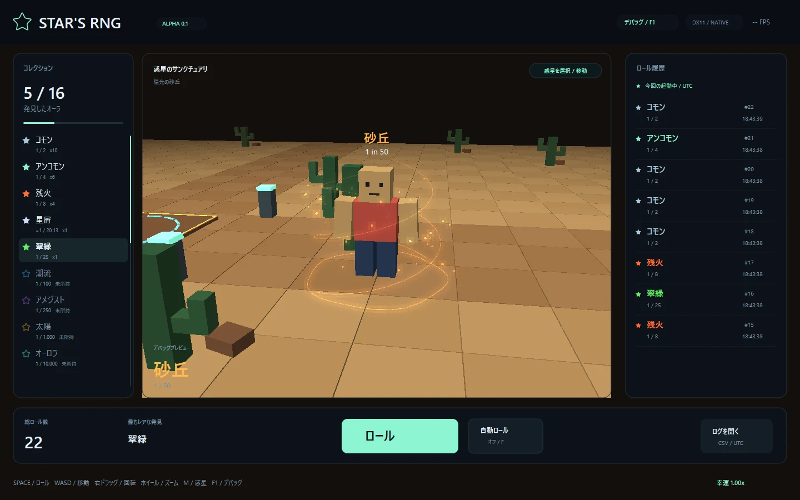
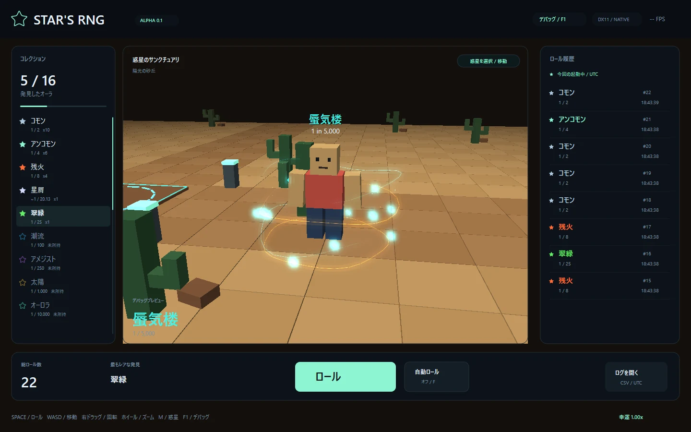
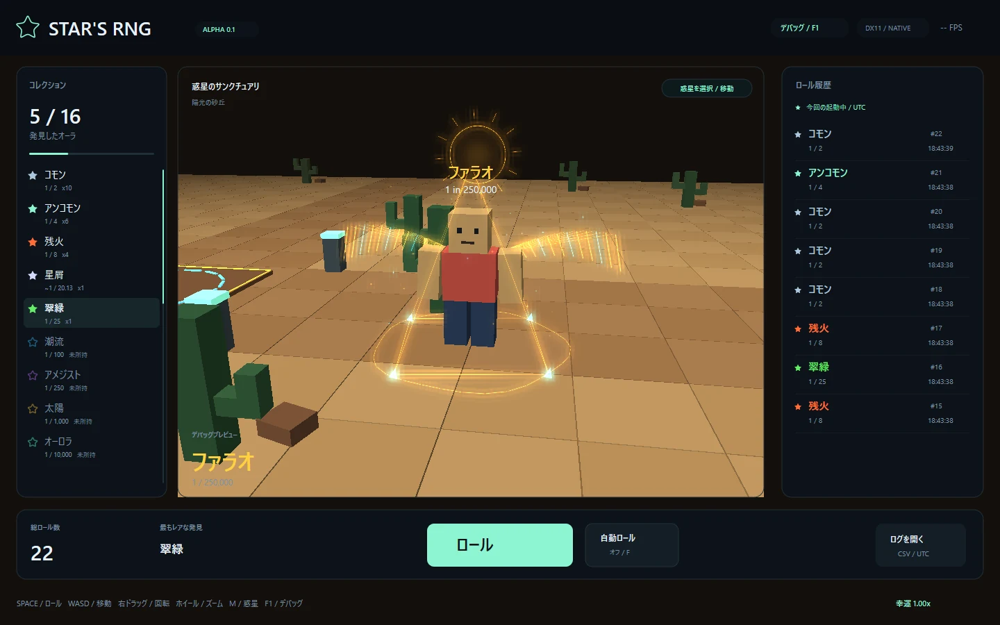

# 砂漠のオーラ3種類

全惑星の通常ロールから取得できます。F1 → オーラの専用ボタンからは、未所持でも表示だけ確認できます。プレビューで所持数やロール履歴は増えません。

| オーラ | Luck 1倍の基礎確率 | 見た目 |
| --- | --- | --- |
| Dune / 砂丘 | 1 in 50 | 砂色のらせんと細かい砂粒 |
| Mirage / 蜃気楼 | 1 in 5,000 | 青緑の結晶と揺れる光の弧 |
| Pharaoh / ファラオ | 1 in 250,000 | 金のピラミッド・翼・太陽 |

## 自分で変えてみる

ソースZIPの `src/tuning/desert.hpp` を開き、まず1つだけ変更して保存し、ゲームを閉じて `Develop.cmd` を実行します。

- `DuneRadius = 1.75f` を `2.2f`：砂のらせんが外側へ広がります。
- `DuneSpeed = .65f` を `.35f`：砂の回転がゆっくりになります。
- `SandColor`：赤・緑・青の順に発光の色を変更します。

Mirage・Pharaohにも個別の調整値と日本語コメントがあります。通常の歩行アニメーションを使い、Illusionaryのような固定ポーズは持ちません。

確率は `data/auras.csv` の分母で指定します。今回の追加分はStardustの残余配分から取り、Common 1/2・Uncommon 1/4と、他の分母指定済みオーラは維持しています。
