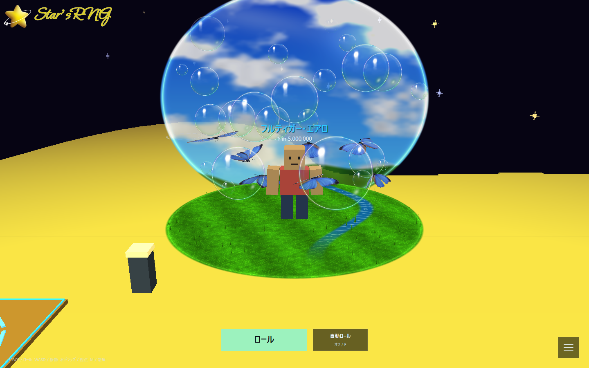

# Frutiger Aeroを自分で変えてみる

緑の草原、青空と雲、透明なシャボン玉、羽ばたく青い蝶を組み合わせたExtraオーラです。Extraステージのロールで入手でき、Luck 1倍の基礎確率は **1 in 5,000,000** です。F1 → オーラからは未所持でも見た目を確認できます。表示だけのプレビューでは所持数やロール履歴は増えません。

足元は丸い芝生と小川です。背後の大きなガラスの景色に空、流れる雲、太陽、緑の丘を映し、周りには虹色の薄い膜を持つ泡を飛ばしています。v0.1.24から、青い蝶は提供されたGLBの立体モデルとテクスチャで描きます。モデルに含まれる約1.25秒の羽ばたきをループし、7匹が少しずつ違うタイミングでプレイヤーの周りを飛びます。草・空・泡は従来どおりコードで描き、白い映り込み、透明な中心、細い輪郭で光沢を出します。

## 青い蝶の素材

モデルは`data/models/blue-butterfly.glb`です。元のGLBファイルを変更せずに同梱し、ゲーム内で大きさと配置を調整します。メッシュとテクスチャは1つを共有するため、7匹分の同じ素材を別々に読み込む構成にはしていません。画像やファイルを毎フレーム読み直すこともありません。

作者は[Erina eka syaharani](https://sketchfab.com/erinaekasyaharani)、作品名は[blue butterfly](https://sketchfab.com/3d-models/blue-butterfly-4fe9c2835522458a822b5b784a680de4)、ライセンスは[CC BY 4.0](https://creativecommons.org/licenses/by/4.0/)です。提供GLB内の表記を引き継ぎ、[モデルのクレジット](../data/models/README.md)を一緒に配布します。

GLBが欠けている、または読み込めない場合は、ゲームを止めずに従来の数式で描く蝶へ戻します。モデルを差し替えて配布する場合は、その素材の作者・出典・ライセンスと変更内容も記載してください。この同梱モデルの許可が、別のGLBや私有VRMにも適用されるわけではありません。

## 最初は草原を広げる

1. ソースZIPを展開し、`src/tuning/frutiger.hpp`を開きます。
2. `MeadowRadius=4.7f`を`MeadowRadius=5.5f`へ変更します。
3. Ctrl+Sで保存し、起動中のゲームを閉じます。
4. プロジェクト直下の`Develop.cmd`を実行します。
5. F1 → オーラ → Frutiger Aeroを表示し、足元の草原が広がったか確認します。

値を保存しただけでは実行中のゲームは変わりません。C++の値を変えた場合は、再ビルドと再起動が必要です。元に戻すときも数値を戻して同じ手順で確認します。

## どの値で何が変わる？

長さはゲーム内座標です。ブロックアバターの身長が約3なので、`1.f`はその約3分の1の長さと考えてください。色は赤・緑・青の順で、各成分は0〜1です。

| 変えたいもの | 設定と標準値 | 変更例と画面で起こること |
| --- | --- | --- |
| 草原の広さ | `MeadowRadius=4.7f` | `5.5f`で芝生と小川が一緒に広がる |
| 草原の高さ | `MeadowHeight=.13f` | `.20f`で床全体が少し持ち上がる。ステージとのちらつきが出る場合は0に近づけすぎない |
| 草の色 | `GrassColor={.22f,.64f,.035f}` | `{.32f,.72f,.08f}`で黄緑へ寄せる |
| 立体の草の量 | `GrassBladeCount=128` | `64`で半分。`0`でも平面の芝生と小川は残る |
| 草の背丈 | `GrassBladeHeight=.25f` | `.40f`で周囲に生える葉が高くなる |
| 風 | `GrassSwaySpeed=1.35f` | `.65f`で揺れがゆっくり。`0.f`で静止 |
| 背後の空の大きさ | `SkyWidth=11.8f`、`SkyHeight=9.6f` | 横幅だけ`13.f`にすると、空のガラスの景色が横へ広がる |
| 背後の空の位置 | `SkyCenterHeight=4.15f`、`SkyDistance=4.f` | 高さ`4.6f`で空を上へ、距離`5.f`でプレイヤーから奥へ移動 |
| 雲の流れ | `CloudSpeed=.025f` | `.0125f`で半分の速さ。`0.f`で雲が止まる |
| 泡の数 | `BubbleCount=22` | `12`で飛ぶ泡を減らす。見た目の目印となる両脇の大きな泡2つは残る |
| 泡の大きさ | `BubbleMinSize=.36f`、`BubbleMaxSize=1.75f` | 最大を`2.1f`にすると大きな泡の割合が増える |
| 泡の昇る速さ | `BubbleRiseSpeed=.12f` | `.06f`でゆっくり。`0.f`で高さの上昇が止まる |
| 泡の透明度 | `BubbleOpacity=.94f` | `.65f`で飛ぶ泡が薄くなる。中心が透明で縁が明るい性質は保つ |
| 蝶の数 | `ButterflyCount=7` | `4`で少なめ、`10`で華やかになる |
| 蝶の大きさ | `ButterflySize=1.2f` | `1.6f`で模様が見やすい大きな蝶になる |
| 蝶の周回 | `ButterflyOrbitSpeed=.24f` | `.12f`で半分の速さ。負にすると周回方向が逆になる |
| 蝶の羽ばたき | `ButterflyAnimationSpeed=1.f` | `.5f`でGLBの羽ばたきが半分の速さ、`2.f`で2倍、`0.f`で静止 |
| 蝶の正面方向 | `ButterflyModelYaw=0.f` | `3.14f`でモデルの前後を約180度回す。単位はラジアン |
| 蝶の傾き | `ButterflyModelPitch=0.f` | `1.57f`で約90度起こす |
| 小さな光の数 | `SparkleCount=14` | `7`で控えめ、`0`で星型のきらめきだけ消す |

数の設定には安全範囲があります。`static_assert`でエラーになったら、まず元の値へ戻してください。草・空・泡などの板は、既存オーラの発光用バッチとは分けて描画します。GLBの蝶は1匹3メッシュを共有して描くため、数を増やすほど描画回数も増えます。`ButterflyFlapSpeed`と`ButterflyColor`は、モデルが欠けたときの従来の蝶だけに使います。通常のGLBの模様はテクスチャから読みます。

## 処理を追う順番

まずは`src/render/frutiger.cpp`を読みます。`buildFrutiger()`は草原と草の葉、背後の空、泡、きらめき、モデルがない場合の蝶を用意します。`loadButterfly()`はGLBを最初に読む場所、`drawFrutigerButterflies()`はGLBの蝶をプレイヤーの周りへ配置して描く場所です。個数・大きさ・周回の数値は`src/tuning/frutiger.hpp`を使います。

`createFrutiger()`は板をGPUで描く準備です。その上にある`FrutigerShader`は、一枚の板の各ピクセルを何色にするか決めます。草の模様、雲の形、泡の虹色や映り込みを変えたくなったときに読む部分です。GLBの頂点・テクスチャ・アニメーションを読む処理は`src/render/glb_model.cpp`へ分けています。大きさや速度の変更だけなら、この専門部分へ触る必要はありません。

泡は中心が透けるため、板をカメラから遠い順へ並べます。これを外すと、近い泡の向こうにある蝶や空の重なりが不自然になります。景色と光沢はコードで作り、蝶だけを同梱GLBで描きます。元のオーラ参考画像はゲームに貼り付けていません。
