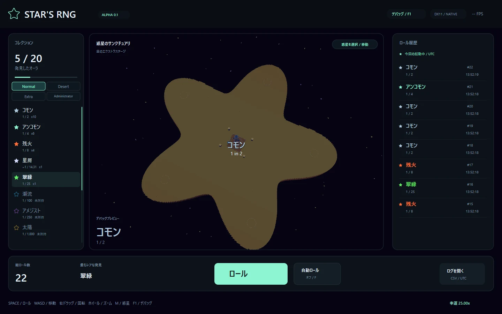
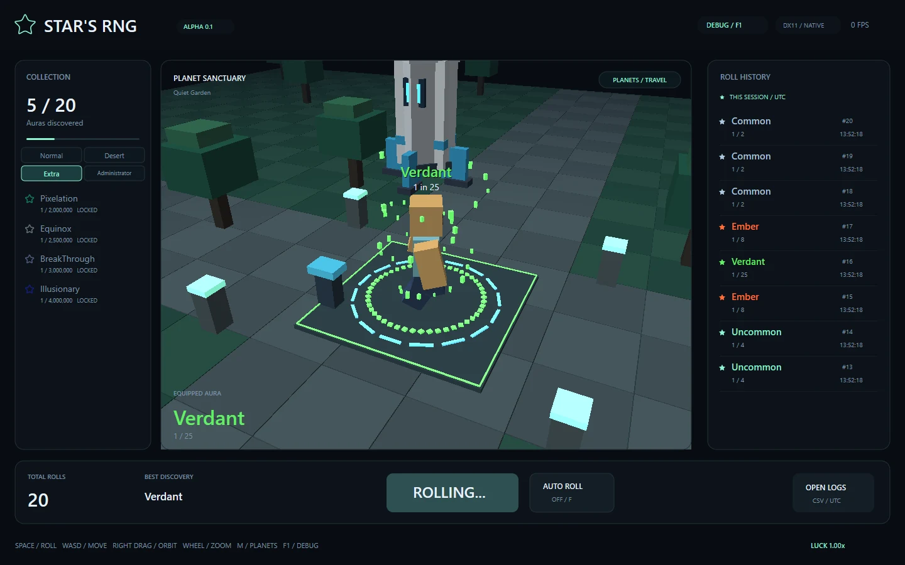
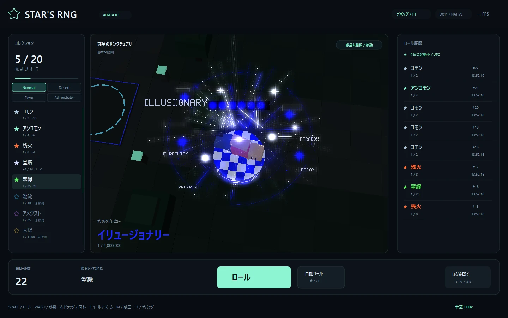

# IllusionaryとExtraの確認・改造ガイド

今回の見た目を試すなら、**F1 → オーラ / Auras → Illusionaryを表示**から始めます。未所持でも確認でき、プレビューで所持数やRoll Historyは増えません。AutoRollは停止します。実際に入手したオーラは、Collectionから装備できます。

## Illusionaryで変わったところ

- アバターは頭が右、足が左になる横向きの姿勢です。片脚を曲げ、腕を胴の脇に置いて浮きます。ブロック・VRMの両方が同じ姿勢を使い、移動中も歩行ポーズを混ぜません。
- `ILLUSIONARY`、`NO REALITY`、`REVERIE`などの文字は、発光のにじみを外して輪郭を残しています。文字の後ろの黒い長方形も取り除きました。黒い軌道の帯や上部の市松模様は演出の一部として残ります。
- 足元の青白チェックは、円周の壁に加えて上面もあります。カメラを上から向けても、中央からステージの地面が透けません。
- 中央の白い光に加え、体の周りを白い光が2つ回ります。2つは反対側から始まり、それぞれ短い白い軌跡を残します。
- 表示中は `data/audio/The_Weirdos.ogg` をBGMとして再生します。F1の音楽設定で別の場所のファイルも指定できます。

## 数字を変えて見比べる

ソース側の数値は、**保存 → ゲームを閉じる → `Develop.cmd` → F1で対象を表示**の順で反映します。一度に一つだけ変えると、何が変化したか分かりやすくなります。

| 開くファイル | 変更する値の例 | 画面で起きること |
| --- | --- | --- |
| `src/tuning/avatar.hpp` の `illusionary` | `BodyRoll = -1.48f` を `-1.20f` | 横向きの体が少し起き上がる。角度の単位はラジアン |
| 同じ場所 | `Lift = .90f` を `1.10f` | 姿勢全体が0.20だけ上へ移動する |
| 同じ場所 | `Knee`の2番目を `-.82f` から `-.60f` | 曲げた側の膝が少し伸びる |
| `src/tuning/illusionary.hpp` | `TextSelfLight = 1.22f` を `1.f` | 文字だけが少し暗くなる。周囲の発光は変わらない |
| 同じ場所 | `TitlePixelSize = .043f` を `.050f` | ILLUSIONARYの文字が大きくなる |
| 同じ場所 | `FloorCellSize = .51f` を `.40f` | 床のチェックが細かくなる |
| 同じ場所 | `OrbitLightRadius = 1.92f` を `2.2f` | 白い光が体から遠い場所を回る |
| 同じ場所 | `OrbitLightSpeed = 1.05f` を `.7f` | 白い光の周回がゆっくりになる |
| 同じ場所 | `OrbitTrailAngle = .76f` を `1.f` | 白い光の後ろに続く軌跡が長くなる |

処理そのものは `src/render/illusionary.cpp` を上から読むと追えます。黒い帯 → 放射線 → チェックの壁と床 → 白い周回光と星 → 小さな画面と文字の順です。姿勢の計算は `src/core/animation.cpp` の `illusionaryPose()` が担当します。

文字や床を描く不透明な板と、ぼかして光らせる板は分けています。文字の明るさだけを変えたいときは `White` の色全体ではなく、`TextSelfLight` を使ってください。

## Extraへ行く

**Mキー**または**惑星を選択 / 移動**から、`Extra`を選びます。丸みのある黄色い星の上がステージで、ロケットの発着場は他の惑星と同じリスポーン地点です。星の輪郭の外側へは歩いて出られません。F1のワールド設定から直接切り替えることもできます。

| Collectionの分野 | 入っているオーラ | ロールで入手できる場所 |
| --- | --- | --- |
| Normal | CommonからSingularityまでの初期オーラ | すべての惑星 |
| Desert | Dune、Mirage、Pharaoh | 砂漠のみ |
| Extra | Pixelation、Equinox、BreakThrough、Illusionary | Extraのみ |
| Administrator | Nanally | F1の表示確認専用。ロールでは出ない |

Collectionはこの4分野をフォルダーのように切り替えて見られます。表示の分類を切り替えても、現在の惑星や装備は変わりません。以前に入手したオーラは、入手場所から別の惑星へ移動しても装備できます。

Extra限定4種類の**Luck 1での基礎確率**は次のとおりです。

| オーラ | 基礎確率 |
| --- | --- |
| Pixelation | 1 in 2,000,000 |
| Equinox | 1 in 2,500,000 |
| BreakThrough | 1 in 3,000,000 |
| Illusionary | 1 in 4,000,000 |

ExtraでもNormalのオーラを入手できます。Dune・Mirage・Pharaohは砂漠限定です。惑星で抽選対象が変わり、Stardustはその惑星の抽選表で残った確率を受け持ちます。Luckを変えると実際の抽選分布も変わります。

確率は `data/auras.csv`、分類と出現条件は `src/core/aura.cpp` の `auraCategory()` / `availableInBiome()` にあります。オーラのIDはセーブと対応する名前なので、既存のIDを気軽に変えないでください。

## Extraの星を改造する

`src/tuning/stages.hpp` の `Extra`で始まる値が入口です。

| 値 | 初期値 | 変更の効果 |
| --- | --- | --- |
| `ExtraInnerRadiusRatio` | `.55f` | 大きくすると星の谷が浅くなり、ふっくらする |
| `ExtraOuterRadiusRatio` | `.97f` | 大きくすると星の先端が遠くへ伸びる |
| `ExtraPlanetThickness` | `2.2f` | 大きくすると横から見た星の床が厚くなる |
| `ExtraSkyStarCount` | `54` | 増やすと周囲に浮かぶ小さな星が増える |

輪郭と歩行範囲は `src/core/stages.hpp` の同じ計算を使います。見た目だけ大きくして歩行範囲を置き去りにすることを防いでいます。全体の広さを変えたい場合は、`src/tuning/world.hpp` の `HalfExtent` も確認してください。

カットシーンの試し方と時間の調整は、[惑星とカットシーンのガイド](stage-and-cutscene-guide.md)へ。将来の機能に必要な準備は[今後の設計メモ](next-features.md)にまとめています。

