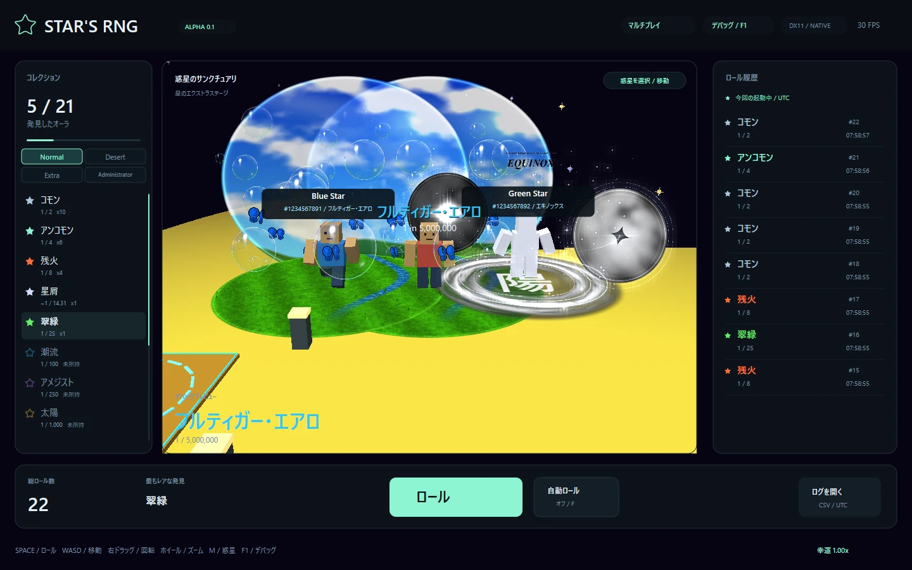

# マルチプレイの使い方と専用サーバー



この版は、専用サーバーを通じて**同じ惑星にいる人の位置・向き・歩行・服の色・表示オーラを一緒に見る**ための最初のマルチプレイです。最大32人、約10回/秒で更新します。ロール回数、所持オーラ、Luck、セーブデータは各PCに保存し、サーバーには送信しません。インターネットで遊ぶ場合はホストが用意したHTTPS URLへ参加します。サーバーを自分で運用する場合はVPSとHTTPS用のドメインが必要です。

## ゲームから参加する

1. 上部の**MULTIPLAYER / マルチプレイ**を開き、自分のUserNameを設定して「確定・保存」を押します。未設定なら接続前に名前を入力します。
2. プロフィール写真を選べます。写真はゲーム側で160×160のPNGに変換し、その小さな画像だけをサーバーへ送信します。選択しなければ既定アイコンです。元の写真、元ファイル名、メタデータは相手に送信しません。
3. ホストから教えてもらったHTTPS URL、例 `https://rng.example.com` を入力し、接続します。**ゲームを起動しただけでは自動接続しません。**
4. 接続が成功するとプロフィール画面が閉じ、そのまま移動・右ドラッグの視点操作・Rollを使えます。同じサーバー・同じ惑星の人が見えます。違う惑星に移動した人はその惑星で表示されます。
5. 名前や写真を変えた場合は自動で再接続して反映します。サーバー停止や通信障害の間も、一人用のロールは続けられます。

**プロフィールを閉じても接続は続きます。** 「ゲームに戻る」またはEscで閉じられます。F1を押すとプロフィールを閉じてデバッグ画面へ切り替わり、未所持オーラやLevelもプレビューできます。通信を終了したい場合だけ「切断する」を押してください。

相手へ共有するのは**現在画面に表示しているオーラとLevel**です。F1の一時プレビューも相手に見えますが、実際の装備・所持数・Roll Historyには登録しません。「コレクションの装備に戻す」で実装備の表示へ戻ります。相手の私有VRMはダウンロード・配布せず、オンラインの相手は共通のブロックアバターとして表示します。近い4人は詳細なオーラ、それ以外は色と輪の軽い表示です。

## UserIDと秘密鍵

- UserNameは自由に変えられる表示名です。重複も可能です。
- UserIDは初回起動時にWindowsの暗号用乱数で作る**10桁の数字**です。UserNameとは別で、PCに保存します。先頭は0になりません。
- 同時に256bitの秘密鍵も作ります。`multiplayer_identity.json`にはUserIDと、WindowsのCryptProtectDataで暗号化した秘密鍵を保存します。**このファイルは公開ZIPやGitHubに入れないでください。**
- サーバー側は秘密鍵そのものを保存せず、ランダムsaltとSHA-256の照合値を保存します。通信はHTTPSで暗号化します。
- 偶然、他人が先に同じUserIDを予約していた場合は、新しいIDと秘密鍵を生成・保存して再試行します。同じID・秘密鍵での二重接続は拒否します。もう一つのゲームを切断するか、最終通信から12秒待ってください。
- Windowsアカウントを変えると秘密鍵を復号できません。IDを引き継ぐ場合は元のWindowsアカウントと保存データを保持してください。別アカウントで新規参加する場合は、ゲームを終了して自分の`multiplayer_identity.json`をバックアップ後に削除すると新IDになります。ロールのセーブとは別のファイルです。

IDはプレイヤー表示の識別用で、今の版ではアカウントログインやクラウドセーブの代わりにはなりません。

## まず自分のPCで動かす

Python 3.10以上が必要です。追加のPythonライブラリーは不要です。Windowsなら同梱の**Start-local-server.cmd**を開き、サーバーのウィンドウを開いたままゲームから参加します。手動の場合は、展開先で次を実行します。

```powershell
python server/serve.py --host 127.0.0.1 --port 8765 --data-dir server-data
```

ゲームの接続先を`http://127.0.0.1:8765`にします。HTTPを許すのは`localhost`、`127.0.0.1`、`::1`だけです。LANやインターネットのIPアドレスへHTTP接続することはできません。公開時は次のHTTPS構成を使ってください。`Ctrl+C`でサーバーを終了できます。

ブラウザーで`http://127.0.0.1:8765/health`を開くと、稼働状態・接続人数・protocol=1を確認できます。UserName、秘密鍵、トークンは表示されません。

## XServer VPSで公開する

構成は次の通りです。

```text
Windowsゲーム → HTTPS :443 → Caddy → 127.0.0.1:8765 Python専用サーバー
```

Ubuntuなどのsystemdが使えるLinuxを想定します。VPSの契約・ドメイン購入・実際のデプロイは、このソースに含まれるサーバーとは別の作業です。

1. XServer VPSを用意し、SSHでログインできる状態にします。Python 3.10以上とCaddyを、そのOSの公式手順でインストールします。
2. 自分のドメインのDNS AレコードをVPSのIPv4へ向けます。AAAAも設定する場合は、IPv6側も同じVPSで到達できるようにします。
3. **XServer VPS側のパケットフィルターとOS側のファイアウォールの両方**でTCP 80/443を許可します。SSH用ポートは管理元に合わせて許可します。Python用8765は外部へ開けません。
4. ソースZIP内の`server`フォルダーを`/opt/stars-rng/server`へコピーします。ゲームのEXE、音楽、VRMはサーバーには不要です。
5. 以下のコマンドで専用ユーザーを作成し、同梱systemd設定を配置します。既存ユーザーがある場合は作成部分を省略します。

```sh
sudo useradd --system --home /var/lib/stars-rng --shell /usr/sbin/nologin starsrng
sudo install -m 644 /opt/stars-rng/server/stars-rng.service /etc/systemd/system/stars-rng.service
sudo systemctl daemon-reload
sudo systemctl enable --now stars-rng
curl http://127.0.0.1:8765/health
```

6. `server/Caddyfile.example`内の`rng.example.com`を自分のドメインへ変更し、既存サイトと競合しないように`/etc/caddy/Caddyfile`へ配置します。既存Caddyfileがある場合は、その設定にサイトブロックを追加します。

```sh
sudo caddy validate --config /etc/caddy/Caddyfile
sudo systemctl reload caddy
curl https://rng.example.com/health
```

7. ゲームの接続先に`https://rng.example.com`を入力して参加します。友人にも同じアドレスを伝えます。証明書エラーがある場合は、証明書検証を無効にせずDNS・時刻・80/443への到達性を確認します。

XServer VPSの公式[パケットフィルター設定](https://vps.xserver.ne.jp/support/manual/man_server_port.php)と、Caddy公式[Reverse proxy quick-start](https://caddyserver.com/docs/quick-starts/reverse-proxy)を参照してください。

## 運用時に保存するもの

`/var/lib/stars-rng/identities.json`は予約済みUserIDの照合情報です。秘密鍵の平文は含みませんが、管理者用の非公開データとしてバックアップします。フォルダー0700・ファイル0600で、systemdの専用ユーザーだけが読み書きします。原子的なファイル置換で保存します。同じdata-dirを複数プロセスで同時利用しないでください。

位置・セッション・プロフィール写真はメモリ上だけにあり、最終更新から12秒で退出扱いです。サーバー再起動で全員が切断されるので、ゲームから再接続します。アクセスログにリクエスト本文やAuthorizationヘッダーを追加しないでください。

この版は、友人向けの小規模なサーバーを想定しています。登録制アカウント、招待コード、BANや管理画面、チャット、トレード、サーバー側での不正検出は含みません。表示位置・オーラはクライアントからの申告であり、抽選や所持を証明する情報ではありません。公開コミュニティで競争や取引を行う前に、サーバー主体の進行管理・認証・通報と管理機能を追加してください。

## コードを変更するとき

| 場所 | 役割・値を変えるとどうなるか |
|---|---|
| `src/platform/multiplayer.hpp` | ゲームと通信処理が渡すデータ。LocalPlayerが自分、RemotePlayerが相手。 |
| `src/platform/multiplayer.cpp` | WinHTTPの専用スレッド。約100msごとに更新し、ゲームの描画スレッドは通信を待たない。 |
| `src/platform/main.cpp` | プロフィールを閉じる処理、移動入力、現在表示中のオーラ・Levelを通信へ渡す処理。接続状態とメニューの開閉は別々に扱う。 |
| `server/serve.py` の `MAX_PLAYERS` | 同時接続人数。増やす場合はクライアントの人数検証・描画負荷・試験も一緒に変更する。 |
| `server/serve.py` の `SESSION_TIMEOUT` | 通信が止まった相手を消すまでの秒数。短すぎると回線の揺らぎで切れやすくなる。 |
| `server/stars-rng.service` | Linuxでの自動起動・専用ユーザー・保存フォルダー。 |
| `server/Caddyfile.example` | 外向きHTTPSとVPS内Pythonへの転送。 |
| `tests/multiplayer_server_tests.py` | localhostへ本当に2人接続する試験。移動・惑星・画像・認証・制限・退出を確認する。 |

APIはprotocol=1です。`POST /v1/join`でID/秘密鍵/UserName/任意PNGを送り、短命のセッショントークンを受け取ります。以降の`POST /v1/update`、`POST /v1/leave`、`GET /v1/photo/<id>/<hash>`は`Authorization: Bearer ...`を使います。秘密情報をURLへ入れません。画像は最初の取得時と写真が変わった時だけダウンロードします。

入力は文字数、有限数、範囲、JSONフィールド、PNG寸法/CRC/展開サイズを検査します。写真上限128KiB、JSON上限192KiB、1セッション25更新/秒未満、接続試行は接続元ごと60回/分までです。Caddy構成では接続元が127.0.0.1になるので、60回/分はサーバー全体の上限になります。更新は10回/秒が標準です。

```sh
python tests/multiplayer_server_tests.py
```

プロトコルを変更した場合はprotocol番号を上げ、古いクライアントを誤解釈しないようにします。将来クラウドセーブを実装する場合は、この位置共有APIへ所持数を付け足すだけで済ませず、サーバーが抽選結果・所有権・保存を決定する設計に切り替えます。

## 自分のPCで2人分を試す

1つ目のゲームを通常起動し、2つ目は別の保存先を指定して起動します。パッケージのフォルダーで次を実行します。

```powershell
.\StarRng.exe --save-dir=.\local-test-player-2
```

この指定がある時だけ複数起動を許可します。2つのゲームで別の名前を確定し、どちらもlocalhostのサーバーへ参加してください。2つ目のID・ロール・設定はlocal-test-player-2へ分けて保存します。通常のセーブは変更しません。
