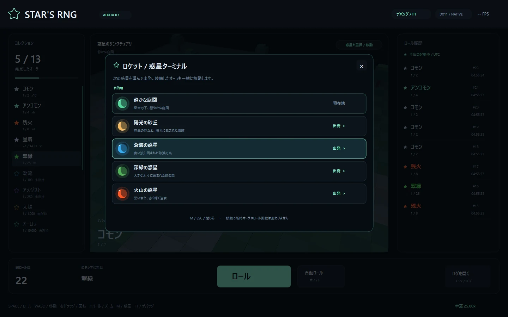

# 惑星の移動と、カットシーンの調整

## ロケットで別の惑星へ行く

1. ゲーム画面の右上、ワールド枠にある **「惑星を選択 / 移動」** を押します。
2. 行き先のカードを押すとロケットが出発します。
3. 離陸 → 星の海を移動 → 着陸の後、新しいステージを歩けます。

庭園・砂漠・海・森・火山・Extraを選べます。Extraは丸みのある黄色い星の上のステージです。現在いる惑星には「現在地」と表示します。
**Mキー** でも選択画面を開けます。右上の **×** または **M / Esc** で閉じられます。
移動では、所持オーラ・装備オーラ・ロール回数を変更しません。

**F1 → ワールド → 惑星 / ステージ** からは、ロケット演出を挟まずに景観を直接切り替えられます。
ステージの制作中に、すぐ見比べたいときに使ってください。

ロケットは各惑星のリスポーン地点にあります。Extra限定はPixelation・Illusionary・BreakThrough・Equinox・Frutiger Aero・Red johnの6種類です。Frutiger Aeroは基礎確率1 in 5,000,000で、草原・青空・雲・光沢のある泡・青い蝶をまといます。Red johnは1 in 6,000,000で、座るアバターと部屋・ベッド・赤い顔を表示します。[Frutiger Aero](frutiger-aero.md)・[Red john](red-john-guide.md)の調整ガイドと、[Collectionの4分野](illusionary-and-extra-guide.md)も参照してください。カタログ全体は23種類、Nanallyを除いて取得可能なものは22種類です。

マルチプレイへ参加中は同じ惑星の相手がワールドに表示されます。たとえば片方が庭園、もう片方がExtraなら、Extraへ移動すると会えます。ロケット移動でUserNameや10桁のUserIDは変わりません。F1のオーラプレビューも現在の見た目として相手へ共有しますが、所持品は増えません。接続方法とXServer VPSの準備は[マルチプレイのガイド](multiplayer.md)にあります。接続先はホストのHTTPS URLを使用してください。

## カットシーンを試す

**F1 → オーラ / Auras → Equinox・BreakThrough・Red john → カットシーンのみ再生**で確認できます。試しに再生しても、オーラの所持数とRoll Historyは増えません。AutoRollは停止します。

EquinoxとRed johnは最後の0.8秒で映像と音楽を一緒にフェードし、対応するオーラへ切り替えます。BreakThroughは終わる直前まで映像と音量を保ち、30秒で即座に対応オーラへ切り替えます。入手時もF1の確認用再生も同じ動きです。

終了後の表示は一時プレビューなので、Collectionで選んだ装備は変更しません。F1の装備表示へ戻す操作、またはCollectionでの装備選択で通常の表示へ戻せます。再生中に**Esc**で中断した場合は、再生前の表示へ戻ります。

カットシーンの映像はコードで描いています。参考MP4を動画として画面へ貼り付けているわけではありません。Equinox・BreakThrough・Red johnの音声は、提供者の許可を得て元動画から音声だけを切り出して同梱しています。元の動画がなくても音付きで確認できます。参考画像と元動画は配布しません。

| カットシーン | 同梱する音声 | 演出の長さ |
| --- | --- | --- |
| Equinox | `data/audio/Equinox_Cutscene.m4a` | 10.9秒 |
| BreakThrough | `data/audio/Breakthrough_Cutscene.m4a` | 30秒 |
| Red john | `data/audio/Red_John_Cutscene.m4a` | 10.9秒 |

同梱音声がない場合は、手元のDownloadsの`EquinoxReworkedCutscene.mp4.mp4`または`BreakthroughCutsceneV2.mp4.mp4`から音声を探します。BreakThroughの元動画を使う場合だけ、4.5秒を開始位置として読み飛ばします。同梱音声はその区間を切り出し済みなので、0秒から使います。音声が見つからない場合も映像は再生できます。

Red johnはv0.1.19から、提供MP4の0秒から約10.89秒のAAC音声を再圧縮せず抽出した同梱M4Aを使います。同梱M4Aがない場合だけDownloadsの`The-Mentalist-SnapYT.App.mp4`をローカル音声の候補にします。映像はどちらの場合もコードで描きます。帯・目・横顔・タイトルの開始秒と、現在の音声の扱いは[Red johnの調整ガイド](red-john-guide.md#cutsceneの出る時刻を変える)へ。

## BreakThroughの場面とカメラ

v0.1.14でi・iiと後半を初実装のv0.1.6へ戻し、iii・ivはv0.1.13の映像を維持しました。v0.1.15ではivの字幕が出ている区間だけ、参考画像のような白と黒の二値表示を加えています。柱・構造物は静止し、カメラの動きで奥行きを出します。場面の境目は映像を重ねずに切り替え、元の絞り閉鎖・開口も保ちます。冒頭0.25秒の導入フェードと、iiiの冒頭で画面が開く演出も残します。

| 場面 | 時間 | カメラの動き |
| --- | --- | --- |
| i — started with few | 0〜3.4秒 | 初実装の近接カメラ。柱の上部を斜めに映し、少しずつ回り込む |
| ii — only less it gets. | 3.4〜7.3秒 | 初実装の近接カメラ。柱の低い部分へ切り替わり、斜めの画面がゆっくり回る |
| iii — time by time, now empty | 7.3〜11.1秒 | 中央の光のコアへ一直線に接近。後半ほど加速する |
| iv — and there was nothing left. | 11.1〜14.15秒 | ホワイトアウトから視界が戻り、巨大な直方体が複数ある空間へ。広角で光源へゆっくり直進し、カメラだけが少し上下する。字幕が出る13〜14.12秒だけ白地と黒い形の二値表示 |
| get out of my head | 14.15〜15.05秒 | 完全な黒画面へ切り替え、14.2〜15秒だけ文字を表示する |
| it wasn't gone〜最後 | 15.05〜30秒 | 初実装の7本柱の全景に戻り、少しずつ後退しながら回り込む。最後は元の絞り閉鎖と短い閃光を経て、通常のオーラ表示へ即切り替える |

ivの文章は13秒から表示します。`breakthroughIvCaptionVisible()`が真になる13秒以上14.12秒未満だけ、映像を白地・黒形にして字幕を黒帯・白文字で重ねます。灰色のグレースケールではなく、白と黒の2色です。直前の閃光、字幕が消えた後、`get out of my head`以降は従来のままです。`with only 5 fragments left`は、`it wasn't gone`と同じ傾きと横移動で表示します。最後の28〜29秒の絞り閉鎖と29.05秒の短い閃光は、初実装からの映像内の演出です。終了時に通常画面へ重ねるフェードは行いません。

この動きの初期値は `src/tuning/cutscene.hpp` にあります。以下の値はソース側の設定なので、保存後に `Develop.cmd` で再ビルドしてください。字幕のF1調整と違い、実行中のゲームには保存だけでは反映されません。

| 値 | 初期値 | 数字を変えたとき |
| --- | --- | --- |
| `BreakthroughOriginalI` の `distance / targetHeight` | `4.15f / 6.f` | iで柱から離れる距離と、見る場所の高さ。高さを上げると柱の上部を映す |
| 同じ値の `yawSpeed / rollSpeed` | `.035f / .055f` | iで柱の周りを回る速さと、画面が傾く速さ。0でそれぞれ止める |
| `BreakthroughOriginalII` の `distance / targetHeight` | `4.6f / 1.5f` | iiで柱から離れる距離と、見る場所の高さ。距離を下げると柱へ近づく |
| 同じ値の `yawSpeed / rollSpeed` | `.06f / .065f` | iiの周回と画面の傾きの速さ。大きいほど速く動く |
| `BreakthroughCoreRush` の `distanceFrom / distanceTo` | `15.f / .72f` | iiiの最初と最後の距離。最後を小さくするとコアへ深く近づく |
| `BreakthroughRushAcceleration` | `1.65f` | 大きいほどiiiの後半へ加速を寄せる。1なら等速で近づく |
| `BreakthroughCoreFlareDistance` | `9.f` | コアの光が拡大し始める距離。大きいほど早く光に包まれる |
| `BreakthroughWhiteoutSeconds` | `.43f` | ivの閃光から視界が戻る時間。大きいほど白い画面が長く残る |
| `BreakthroughMonolithEnd` | `14.15f` | ivの巨大な柱から黒画面へ切り替える時刻。単位は開始からの秒 |
| `BreakthroughMonolithTravelSeconds` | `18.9f` | ivの前進量を何秒かけて進む速さにするか。小さいほど短いivの中で速く進む |
| `BreakthroughMonolithStartDistance` | `20.f` | ivの開始位置。大きいほど手前から奥を見る |
| `BreakthroughMonolithTravelDistance` | `3.8f` | ivの前進量。大きいほど光源へ近づく |
| `BreakthroughMonolithFocalLength` | `.83f` | 小さいほど広角になり、手前と奥の距離感が強くなる |
| `BreakthroughMonolithBobHeight` | `.055f` | ivのカメラの上下幅。0なら上下動なし |
| `BreakthroughMonolithScale` | `1.f` | ivの巨大な柱全体の倍率。大きいほど圧迫感が増す |
| `BreakthroughIvInkThreshold` | `.35f` | iv字幕中に白と黒を分ける明るさの境界。下げると黒い部分が広がり、上げると白い余白が増える。字幕の表示区間は`breakthroughIvCaptionVisible()`で共有 |
| `BreakthroughBlackoutEnd` | `15.05f` | 黒画面から後半の7本柱へ切り替える時刻 |
| `BreakthroughFinalDistance` / `BreakthroughFinalPullbackSpeed` | `12.2f / .045f` | 後半の最初の距離と、1秒ごとに後退する距離 |
| `BreakthroughFinalYawSpeed` | `.017f` | 後半の7本柱を横へ回り込む速さ。0で回り込みを止める |
| `BreakthroughFloatingCaptionAngle` / `BreakthroughFloatingCaptionSpeed` | `-2.f / 6.f` | `it wasn't gone`と`with only 5 fragments left`の共通の傾きと横移動速度。速度は基準画面高480pxでのpx/秒 |
| `BreakthroughFloatingCaptionMoveSeconds` | `4.f` | 上の2つの文字を何秒間動かすか。出現後この秒数で横移動が止まる |

`BreakthroughOriginalShot`と`BreakthroughShot`の各項目名・数値の並び順は、設定ファイルの冒頭にあります。距離はゲーム内単位、カメラ角度はラジアン、`start / end`はカットシーン開始からの秒です。テロップの`BreakthroughFloatingCaptionAngle`だけは度数です。最初は距離1個だけを変え、F1から再生して比較してください。

通常表示で頭上の名前だけを上げたい場合は、別ファイルの`src/tuning/breakthrough.hpp`にある`titleHeight`を使います。初期値は`3.85f`で、`4.1f`にすると0.25だけ上がります。この値はCutSceneのカメラには影響しません。

## Equinoxの拍と揺れを音楽へ合わせる

**F1 → 音楽**でEquinoxのBPMと拍の時差を変更します。通常のオーラ表示とCutSceneは別の曲なので、それぞれの値を別々に保存します。通常表示は`Koraii_Layers_Cut.mpeg`、CutSceneは従来の`Equinox_Cutscene.m4a`です。

| やりたいこと | 変更例 | 結果 |
| --- | --- | --- |
| 拍の速さを変える | BPM `180 → 120` | 1拍が約0.333秒から0.5秒になり、同期する演出がゆっくりになる |
| 拍を少し遅らせる | 時差 `0 → +.10秒` | 演出の拍が音声より0.1秒遅くなる |
| 拍を少し早める | 時差 `0 → -.05秒` | 演出の拍が0.05秒早くなる |

BPMは30〜300、時差は-2〜+2秒です。初期値は通常曲が180 BPM・+0.044秒、CutSceneが180 BPM・+0.056秒です。変更はその場で反映して自動保存するため、再ビルドは不要です。まずBPMで拍の間隔を合わせ、次に時差で「当たる瞬間」を合わせると調整しやすくなります。

通常表示では4拍で玉が1周し、1拍ごとに白黒を交換して短い爆発を描きます。玉の白黒は常に片方が白、もう片方が黒です。尾は玉の過去の位置をつないだ連続トレイルです。床文字は4拍ごとに「陰→陽→衡→無」と進み、16拍で1巡します。

CutSceneは**実際に再生している音声の時刻**から拍を求め、背景と字幕を一緒に軽く上下させます。以前の「低音の強さをそのまま揺れにする」方式から、BPMと時差で拍をそろえる方式へ変えました。揺れの大きさは`src/tuning/cutscene.hpp`の`EquinoxBassShakeHeight`です。初期値`.008f`は画面高の0.8%で、`.004f`なら半分、`0.f`なら揺れなしになります。こちらはC++の設定なので、変更後に再ビルドしてください。

### 玉の配置・加速と減速・床の回転を変える

v0.1.16では玉を半径1.80へ大きくし、中心を高さ2.70へ下げ、周回半径を3.60へ広げています。下の値は`src/tuning/equinox.hpp`にあり、保存後に`Develop.cmd`で再ビルドします。F1のBPMとは別で、通常のオーラの見た目・動きを調整する値です。

| 調整値 | 初期値 | 変更例と画面で起きること |
| --- | --- | --- |
| `orbRadius` | `1.80f` | `1.5f`で玉だけ小さくする |
| `orbHeight` | `2.70f` | `3.1f`で玉の中心を上へ戻す |
| `orbOrbitRadius` | `3.60f` | `4.f`で二つの玉をさらに体から離す |
| `orbitSpeedVariation` | `.22f` | `.10f`で速度差を小さく、`0.f`で等速にする |
| `orbitSpeedCycleOrbits` | `1.f` | `2.f`で2周かけて加速・減速を1回行う |
| `floorRotation` | `1.10f` | `.55f`で床の模様・円・粒子を一緒に半分の速さで回す |
| `burstRadius` | `1.65f` | `1.f`で色交換時の爆発が広がる距離を抑える |
| `burstBrightness` | `.82f` | `.6f`で爆発の光量を控えめにする |
| `burstFragments` | `18` | `12`で飛ぶ光の破片を減らす |
| `burstRingWidth` / `burstFragmentWidth` | `.15f` / `.070f` | 広がる輪と破片の線の太さを別々に変更する |

`orbitSpeedVariation=.22f`は平均速度の78〜122%です。強さは0以上1未満に保ちます。加速と減速が一組なので、1周期の平均の拍はずれません。玉・トレイル・爆発位置を同じ計算で求めるため、尾や交換時の爆発だけが置き去りにもなりません。`floorRotation`は床文字の切り替え順や音楽のBPMを変更しません。共有する回転だけを止めたい場合は`0.f`です。床の模様自体の変化や粒子の上昇は続きます。

## Equinoxのフェードを長く／短くする

`src/tuning/cutscene.hpp` の `EndingFadeSeconds`が、Equinoxの映像と音の切り替え時間です。`.8f`を`1.2f`にすると、終わりの1.2秒でゆっくりオーラへ移ります。カットシーン全体の長さより短い、正の秒数にしてください。変更後は再ビルドが必要です。

BreakThroughは`endingOpacity()`の第3引数`instantSwitch`を`true`にしているため、この値を変更しても最後の即切り替えは変わりません。映像内の導入フェード、場面ごとの絞り閉鎖・開口、短い閃光は保ちます。これらは、終端で通常画面へ重ねるフェードとは別々です。

## サックスに合わせて字幕を少しずつ調整する

**F1 → オーラ → BreakThrough → 字幕タイミング / 秒** を開きます。
英語表示の場合は **Auras → Caption timing / seconds** です。

最初は「全単語の時差」だけ変更するのがおすすめです。

| やりたいこと | 設定の例 | 画面で起きること |
| --- | --- | --- |
| 字幕全体を0.10秒早くする | `-0.10 s` | 全単語の出現が早くなる |
| 字幕全体を0.20秒遅くする | `+0.20 s` | 全単語の出現が遅くなる |
| `believe` だけ直す | `believe` の秒数を調整 | その単語の出現時刻だけ変わる |
| 最初の状態に戻す | 「字幕タイミングを初期値へ」 | 時差が0になり、各単語も初期時刻に戻る |

「カットシーンのみ再生」を押して、音と字幕を確認します。
再生中も **F1** で調整パネルを開閉できます。パネルにはカットシーン開始からの現在時刻が表示されます。
字幕の値を変えたら、もう一度最初から再生して確認すると合わせやすくなります。

`how` から `world?` までの8個の数字は、**カットシーン開始から何秒後に表示するか** を表します。
その数字に「全単語の時差」を足した時刻に表示されます。
たとえば `how = 22.00 s`、全単語の時差 `-0.10 s` なら、`how` は **21.90秒** で表示されます。
順番が入れ替わらないように、各単語は前後の単語の範囲内で調整できます。

音楽や柱の演出の時計は、この設定では動かしません。
変更内容はプレイヤー設定として自動保存されます。**ゲームの再ビルドは不要** です。
通常版と `Develop.cmd` の開発版はセーブ先が異なるため、調整値も別々に保存されます。

## コード側で初期値を変えるとき

初期の字幕時刻は **`src/tuning/cutscene.hpp`** にまとめてあります。
8個の値は `how / much / do / you / believe / in / this / world?` の順番です。
コードを保存して `Develop.cmd` でビルドし、F1の「字幕タイミングを初期値へ」を押して確認してください。
すでに設定ファイルがある場合は保存済みの値が優先されるため、このリセットが必要です。

画面の見た目は `src/render/ui.cpp`、クリックから出発までの処理は `src/platform/main.cpp`、
移動中の時計は `src/core/stages.hpp` が担当します。
`Renderer::stageSelectUi()` が惑星カード、`Renderer::stageTravelUi()` がロケットの絵を描きます。
